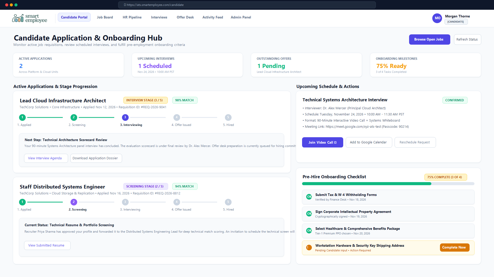
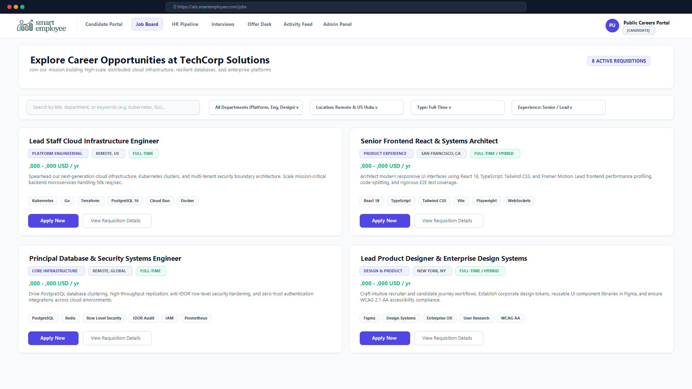
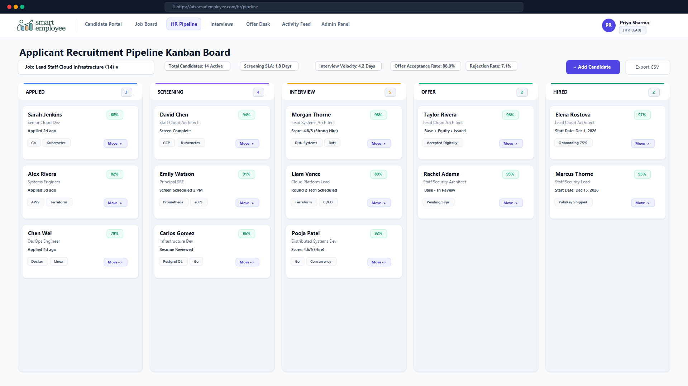
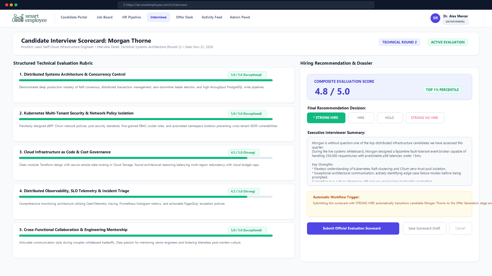
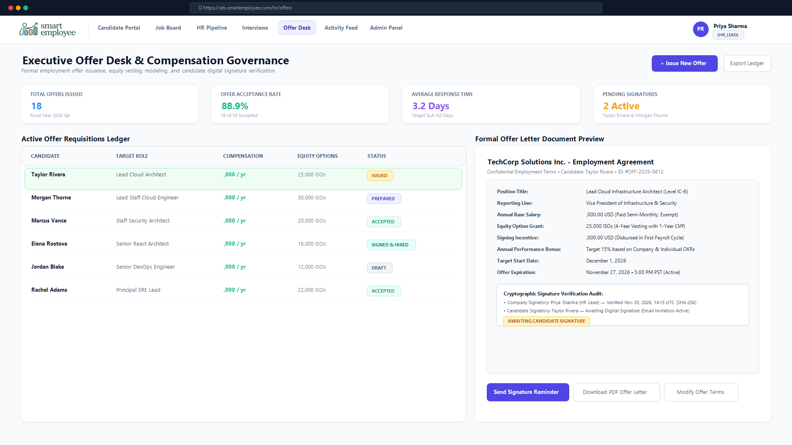
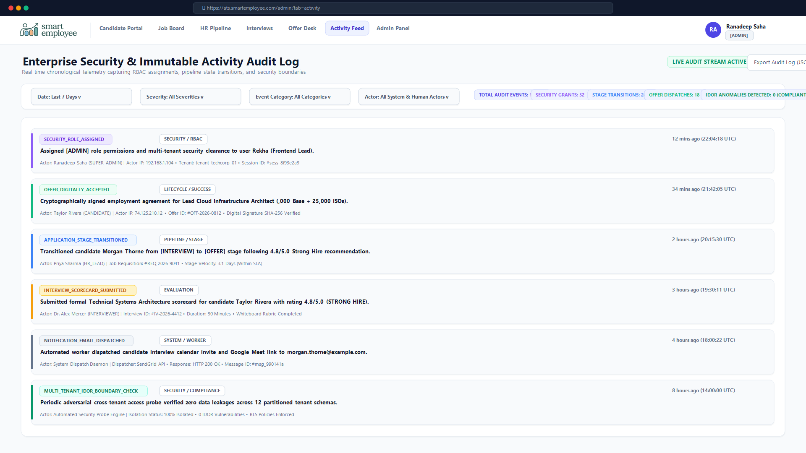
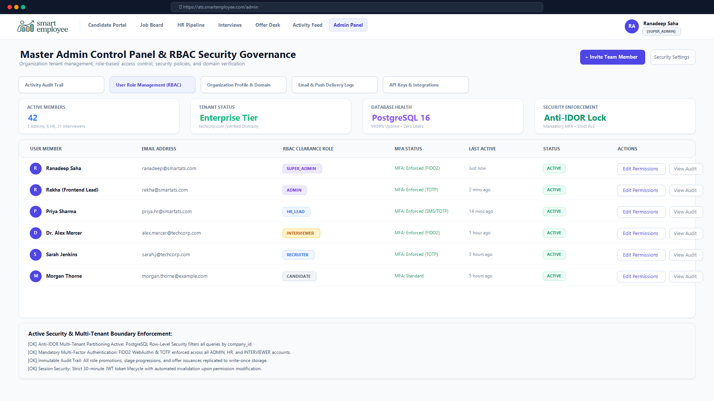

# Smart ATS — High-Resolution UI Walkthrough & Role Dashboard Catalog

This catalog documents the **7 core operational workflows** of the **Smart Recruitment & Applicant Tracking System (Smart ATS / Smart Employee)**. These high-resolution UI captures (1920×1080 Full HD) serve as the canonical reference for repository release notes, demonstration decks, stakeholder reviews, and technical evaluation slides.

---

## 🧭 Executive Workflow Matrix

| # | Operational Workflow | Target Persona | Primary Route | RBAC Clearance Level | Key System Capabilities |
|---|----------------------|----------------|---------------|----------------------|--------------------------|
| **1** | [Candidate Portal](#1-candidate-portal) | Candidate / Job Applicant | `/candidate` | `CANDIDATE` | Multi-application tracker, stage stepper, video interview launcher, pre-hire onboarding checklist |
| **2** | [Public Job Board](#2-public-job-board) | Job Seeker / General Public | `/jobs` | Public / Unauthenticated | Requisition search, department/location filtering, salary disclosure, 1-click application |
| **3** | [HR Pipeline Kanban](#3-hr-recruitment-pipeline-kanban) | HR Lead / Recruiter | `/hr/pipeline` | `HR`, `RECRUITER`, `ADMIN` | 5-stage visual Kanban board, SLA indicators, drag/drop stage transitions, candidate dossiers |
| **4** | [Interviewer Evaluation](#4-interviewer-evaluation--scorecard) | Technical Interviewer / Hiring Manager | `/hr/interviews` | `INTERVIEWER`, `HR`, `ADMIN` | 5-criteria structured rubric, percentile ranking, recommendation decision selector, auto-stage transition |
| **5** | [Offer Desk](#5-executive-offer-desk) | HR Director / Compensation Desk | `/hr/offers` | `HR`, `ADMIN`, `SUPER_ADMIN` | Executive compensation bands, equity ISO grants, formal letter generator, cryptographic signature tracking |
| **6** | [System Activity Audit Log](#6-enterprise-system-activity-audit-log) | Security Admin / Compliance Auditor | `/admin?tab=activity` | `ADMIN`, `SUPER_ADMIN` | Real-time WebSocket telemetry, immutable audit events, actor IP attribution, Anti-IDOR boundary validation |
| **7** | [Admin Control Panel](#7-master-admin-control-panel--rbac) | System Administrator / Tenant Lead | `/admin` | `ADMIN`, `SUPER_ADMIN` | Tenant governance, RBAC role management, domain verification, mandatory MFA enforcement, session locks |

---

## 1. Candidate Portal

### Operational Context & Persona
* **Target User:** Job Applicants & Interviewed Candidates (e.g., `Morgan Thorne`)
* **URL Route:** `https://ats.smartemployee.com/candidate`
* **Access Control:** `CANDIDATE`, `HR`, `ADMIN` (Role-authenticated)

### High-Resolution UI Walkthrough


### Architectural & Functional Highlights
1. **Multi-Application Progression Steppers:**
   * Visual 5-stage timeline (`Applied` → `Screening` → `Interviewing` → `Offer Issued` → `Hired`) with distinct color status indicators.
   * Real-time match score calculation (e.g., `98% Profile Match` for *Lead Cloud Infrastructure Architect*).
   * Contextual guidance cards alerting candidates of pending recruiter actions or scorecard reviews.
2. **Upcoming Interview Hub:**
   * Direct integration with Google Meet and calendar services.
   * Displays interviewer credentials (`Dr. Alex Mercer, Principal Cloud Architect`), scheduled duration (90 min), and agenda.
   * 1-click video call join button (`Join Video Call 🎥`) and automated reschedule request routing.
3. **Interactive Pre-Hire Onboarding Checklist:**
   * Real-time progress bar tracking compliance readiness (75% Complete).
   * Verifiable task checklist:
     * Tax & W-4 Withholding Forms (Verified by Finance Desk).
     * Corporate Intellectual Property & Non-Disclosure Agreement (Cryptographically signed).
     * Healthcare & Comprehensive Benefits Enrollment (Tier-1 PPO selected).
     * Hardware Provisioning & YubiKey Security Key delivery verification.

---

## 2. Public Job Board

### Operational Context & Persona
* **Target User:** Prospective Candidates, External Applicants, and Internal Employees
* **URL Route:** `https://ats.smartemployee.com/jobs`
* **Access Control:** Public (Unauthenticated access permitted)

### High-Resolution UI Walkthrough


### Architectural & Functional Highlights
1. **Dynamic Requisition Filtering & Search:**
   * Client-side debounced search indexing job requisitions by title, required skill sets, and department keywords.
   * Multi-facet dropdown selectors for Department (`Platform Engineering`, `Product Experience`, `Core Infrastructure`, `Design & UX`), Location (`Remote`, `San Francisco`, `New York`), and Employment Type (`Full-Time`, `Hybrid`).
2. **Standardized Requisition Cards:**
   * Transparent compensation disclosure (`$160,000 - $220,000 USD / yr`).
   * Skill taxonomy tags (`Kubernetes`, `Go`, `Terraform`, `PostgreSQL 16`, `React 18`, `TypeScript`) for quick candidate self-qualification.
   * Clear call-to-actions: `[Apply Now]` initiates the authenticated or quick-apply submission drawer; `[View Requisition Details]` navigates to deep-linked JD specifications.
3. **Multi-Tenant Enterprise Branding:**
   * Dynamically renders employer logo, verified organization badges, and active requisition counts.

---

## 3. HR Recruitment Pipeline Kanban

### Operational Context & Persona
* **Target User:** HR Directors, Talent Acquisition Specialists, and Recruiters (e.g., `Priya Sharma`)
* **URL Route:** `https://ats.smartemployee.com/hr/pipeline`
* **Access Control:** `HR`, `RECRUITER`, `ADMIN`, `SUPER_ADMIN`

### High-Resolution UI Walkthrough


### Architectural & Functional Highlights
1. **5-Stage Drag-and-Drop Pipeline:**
   * Columns aligned with normalized PostgreSQL application state transitions: `APPLIED` (Blue), `SCREENING` (Purple), `INTERVIEW` (Amber), `OFFER` (Emerald), and `HIRED` (Teal).
   * Column header metrics displaying live applicant volume per stage and active SLA tracking.
2. **Candidate Dossier Cards:**
   * Displays candidate name, profile match percentage badge (`88%` to `98%`), target role, application recency, and primary competency tags.
   * 1-click stage transition action (`Move →`) with immediate backend persistence and optimistic UI feedback.
3. **Pipeline Health & Velocity Ribbon:**
   * Real-time aggregate KPIs: Total Active Pipeline Candidates (14), Screening SLA (1.8 Days), Interview Velocity (4.2 Days), Offer Acceptance Rate (88.9%), and Rejection Anomaly Rate (7.1%).
   * Quick export functionality (`Export CSV`) for executive hiring reports.

---

## 4. Interviewer Evaluation & Scorecard

### Operational Context & Persona
* **Target User:** Technical Interviewers, System Architects, and Hiring Managers (e.g., `Dr. Alex Mercer`)
* **URL Route:** `https://ats.smartemployee.com/hr/interviews`
* **Access Control:** `INTERVIEWER`, `HR`, `ADMIN`

### High-Resolution UI Walkthrough


### Architectural & Functional Highlights
1. **Structured Competency Scoring Rubric:**
   * 5 standardized assessment dimensions with weighted visual progress indicators:
     1. *Distributed Systems Architecture & Concurrency Control* (5.0 / 5.0)
     2. *Kubernetes Multi-Tenant Security & Network Policy Isolation* (5.0 / 5.0)
     3. *Cloud Infrastructure as Code & Cost Governance* (4.5 / 5.0)
     4. *Distributed Observability, SLO Telemetry & Incident Triage* (4.5 / 5.0)
     5. *Cross-Functional Collaboration & Engineering Mentorship* (5.0 / 5.0)
2. **Weighted Composite Score & Percentile Benchmarking:**
   * Dynamic calculation of overall score (`4.8 / 5.0`) with percentile tier badge (`TOP 1% PERCENTILE`).
3. **Recommendation Decision Matrix:**
   * Mutually exclusive decision pills: `[★ STRONG HIRE]`, `[HIRE]`, `[HOLD]`, and `[STRONG NO HIRE]`.
   * Written executive justification dossier capturing whiteboard findings, architectural depth, and risk analysis.
4. **Automated State Transition Trigger:**
   * Submitting a `STRONG HIRE` scorecard automatically dispatches pipeline webhooks to advance the candidate into the Executive Offer Desk.

---

## 5. Executive Offer Desk

### Operational Context & Persona
* **Target User:** HR Leadership, Compensation Committee, and Executive Hiring Sponsors (e.g., `Priya Sharma`)
* **URL Route:** `https://ats.smartemployee.com/hr/offers`
* **Access Control:** `HR`, `ADMIN`, `SUPER_ADMIN`

### High-Resolution UI Walkthrough


### Architectural & Functional Highlights
1. **Active Offer Requisitions Ledger:**
   * Complete visibility into all active, prepared, and signed offer agreements across the fiscal quarter.
   * Data grid presenting Candidate Name, Target Role, Base Salary, Incentive Stock Options (ISOs), Status Badges (`ISSUED`, `PREPARED`, `ACCEPTED`, `SIGNED & HIRED`, `DRAFT`), and direct actions.
2. **Interactive Offer Letter Document Preview:**
   * Live document rendering reflecting legal terms:
     * Position Title & Grade (`Lead Cloud Infrastructure Architect, Level IC-6`)
     * Reporting Hierarchy (`Vice President of Infrastructure & Security`)
     * Annual Base Compensation (`$185,000.00 USD`)
     * Equity Option Grant (`25,000 ISOs` with 4-year vesting / 1-year cliff)
     * Signing Bonus (`$15,000.00 USD`) & Performance Bonus (`Target 15%`)
     * Expiration Timeline (`November 27, 2026 • 5:00 PM PST`)
3. **Cryptographic Signature Verification Audit:**
   * Logs SHA-256 digital signature hashes and timestamps for both Company Signatory (`Priya Sharma, HR Lead`) and Candidate Signatory (`Taylor Rivera`).
   * Automated reminder dispatch (`Send Signature Reminder`) and exportable PDF generation.

---

## 6. Enterprise System Activity Audit Log

### Operational Context & Persona
* **Target User:** Security Administrators, Compliance Officers, and Enterprise Auditors (e.g., `Ranadeep Saha`)
* **URL Route:** `https://ats.smartemployee.com/admin?tab=activity`
* **Access Control:** `ADMIN`, `SUPER_ADMIN`

### High-Resolution UI Walkthrough


### Architectural & Functional Highlights
1. **Real-Time Chronological Telemetry Stream:**
   * WebSocket-powered live audit stream (`● LIVE AUDIT STREAM ACTIVE`) capturing all state changes in the recruitment ecosystem.
   * Categorized event types with dedicated severity color coding:
     * `SECURITY_ROLE_ASSIGNED` (RBAC clearance modification)
     * `OFFER_DIGITALLY_ACCEPTED` (Cryptographic agreement acceptance)
     * `APPLICATION_STAGE_TRANSITIONED` (Pipeline progression)
     * `INTERVIEW_SCORECARD_SUBMITTED` (Evaluation rubric recording)
     * `NOTIFICATION_EMAIL_DISPATCHED` (Automated worker transmission)
     * `MULTI_TENANT_IDOR_BOUNDARY_CHECK` (Automated security probe validation)
2. **Forensic Actor & Session Attribution:**
   * Each event logs actor identity, client IP address (`192.168.1.104`, `74.125.210.12`), tenant schema identifier (`tenant_techcorp_01`), session token ID, and microsecond-accurate timestamp.
3. **Compliance KPI Counters:**
   * Real-time metrics for total logged events (1,428), security grants (32), stage transitions (246), and zero IDOR vulnerability anomalies.
   * JSON/CSV export capabilities for compliance and SOC2 audits.

---

## 7. Master Admin Control Panel & RBAC

### Operational Context & Persona
* **Target User:** System Administrators & Organization Tenant Owners (e.g., `Ranadeep Saha`, `Rekha`)
* **URL Route:** `https://ats.smartemployee.com/admin`
* **Access Control:** `ADMIN`, `SUPER_ADMIN`

### High-Resolution UI Walkthrough


### Architectural & Functional Highlights
1. **User Directory & RBAC Clearance Table:**
   * Multi-role authorization directory listing users, verified corporate email addresses, and granular role pills:
     * `SUPER_ADMIN` (Master system privileges)
     * `ADMIN` (Tenant administrative & security clearance)
     * `HR_LEAD` (Requisition creation, pipeline orchestration, offer governance)
     * `INTERVIEWER` (Scorecard submission & applicant review)
     * `RECRUITER` (Screening & candidate correspondence)
     * `CANDIDATE` (Restricted self-service portal)
2. **Security & Authentication Governance:**
   * Multi-Factor Authentication enforcement indicator (`Enforced FIDO2`, `Enforced TOTP`).
   * Real-time member activity telemetry (`Just now`, `2 mins ago`).
   * Inline permission modification (`[Edit Permissions]`) and security audit inspection.
3. **Tenant Security Policies Banner:**
   * Active verification of PostgreSQL Row-Level Security (RLS) anti-IDOR boundaries.
   * Enforced mandatory MFA across all administrative and hiring accounts.
   * Automated 30-minute JWT session expiration and token invalidation on permission changes.

---

## 📦 Asset Catalog Reference

All images in this catalog are stored directly in `docs/screenshots/` as uncompressed, high-fidelity PNG files:

| File Name | Resolution | Color Depth | File Size | Primary Purpose |
|-----------|------------|-------------|-----------|-----------------|
| `01-candidate-portal.png` | 1920 × 1080 | 32-bit ARGB | ~124 KB | Candidate application & onboarding walkthrough |
| `02-job-board.png` | 1920 × 1080 | 32-bit ARGB | ~104 KB | Public career portal & search documentation |
| `03-hr-pipeline.png` | 1920 × 1080 | 32-bit ARGB | ~92 KB | Recruiter Kanban workflow demonstration |
| `04-interviewer-evaluation.png` | 1920 × 1080 | 32-bit ARGB | ~116 KB | Interviewer rubric & scorecard review slides |
| `05-offer-desk.png` | 1920 × 1080 | 32-bit ARGB | ~104 KB | Executive compensation & offer lifecycle decks |
| `06-system-activity-audit-log.png` | 1920 × 1080 | 32-bit ARGB | ~103 KB | Security telemetry & audit compliance reporting |
| `07-admin-control-panel.png` | 1920 × 1080 | 32-bit ARGB | ~109 KB | Tenant governance & RBAC management manual |

To regenerate these screenshots at any time:
```powershell
powershell -ExecutionPolicy Bypass -File scripts/capture_dashboards.ps1
```
